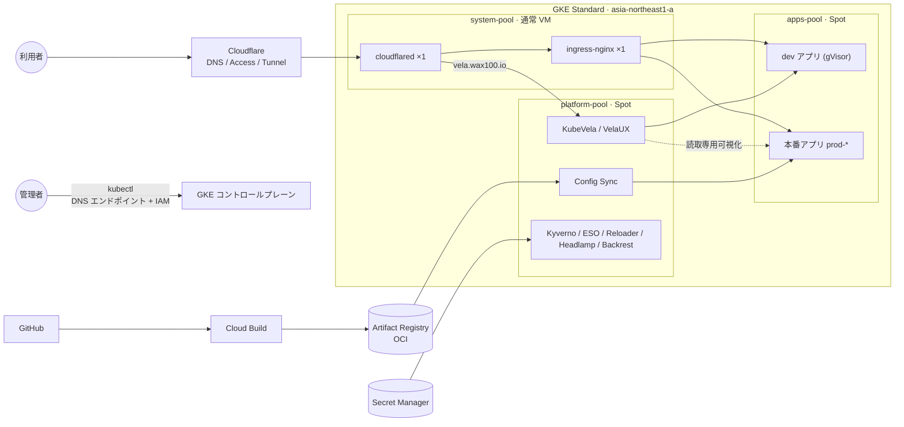

# wax100 k8s-platform

GKE の上で、**開発は [KubeVela](https://kubevela.io/) + VelaUX（Web UI）、本番は GitOps** という分担で動かすためのリポジトリです。インフラは Terraform、クラスタの中身は Config Sync が管理します。

- 開発者は VelaUX の画面からアプリを作り、dev 環境で動かす
- 本番に出すときは Namespace にラベルを 1 回付けるだけ。昇格ジョブ（`vela-promote`）がマニフェストを整えて Pull Request を立てる
- マージすると Config Sync が本番へ同期する。本番の変更はすべて PR を通り、VelaUX の `Production (GitOps Read-Only)` プロジェクトから状態・ログを閲覧できる

アプリと管理画面の外部公開は Cloudflare Tunnel だけで、外部 IP もロードバランサも持ちません。GKE のコントロールプレーンは DNS ベースのエンドポイントからインターネット経由で届きますが（既定で有効）、認可は IAM で行います。管理者の `kubectl` はこの DNS エンドポイントに IAM で入ります（踏み台・VPN なし）。

> 構築手順は [docs/GKE_SETUP_GUIDE.md](docs/GKE_SETUP_GUIDE.md)。

## 公開 URL

| URL                                                | 中身                                                                             | 入れる人                               |
| :------------------------------------------------- | :------------------------------------------------------------------------------- | :------------------------------------- |
| [vela.wax100.io](https://vela.wax100.io)           | VelaUX（dev アプリの作成・デプロイ、本番アプリの状態閲覧）                       | Cloudflare Access で許可したメールだけ |
| [dashboard.wax100.io](https://dashboard.wax100.io) | Headlamp（クラスタの閲覧・バックアップの実行）                                   | Cloudflare Access で許可したメールだけ |
| [backup.wax100.io](https://backup.wax100.io)       | Backrest（バックアップの参照・リストア）                                         | Cloudflare Access で許可したメールだけ |
| `https://dev-<app>.wax100.io`                      | dev のアプリ（VelaUX でドメインを足したものだけ）                                | アプリ次第                             |
| `https://<app>.wax100.io`                          | 本番のアプリ（dev に Ingress / gateway があるか `wax100.io/public=true` のもの） | アプリ次第                             |

管理画面の 3 つは Terraform（`terraform/cloudflare-access.tf`）で Access を付けています。アプリのホスト名は `wax100.io` の 1 階層下だけです（無料の証明書が 1 階層下までのため。詳しくは [docs/DEPLOYMENT_FLOW.md](docs/DEPLOYMENT_FLOW.md)）。
本番に出ているアプリは `components/apps/` のディレクトリ名がそのまま `<app>` です。

## 全体像



| 領域         | 使っているもの                                                                                                                                                                                                                                                                                                                                                                    |
| :----------- | :-------------------------------------------------------------------------------------------------------------------------------------------------------------------------------------------------------------------------------------------------------------------------------------------------------------------------------------------------------------------------------- |
| クラスタ     | GKE Standard（ゾーン、STABLE チャンネル、Dataplane V2、Workload Identity）                                                                                                                                                                                                                                                                                                        |
| GitOps       | Config Sync（OCI モード）← Cloud Build が `kustomize build` した結果を Artifact Registry へ push                                                                                                                                                                                                                                                                                  |
| PaaS         | KubeVela（`vela-core` `1.11.1`）+ VelaUX（`v1.9.5`）。状態は Kubernetes API（`velaux-store`）に保存するため外部 DB 不要。アプリの DB はクラスタ内（containerPort `5432` / `3306` を宣言した PostgreSQL・MySQL・MariaDB コンテナ。公式・Bitnami・`pgvector` 等を含む）で、DB ダンプ・dev アプリ定義・`velaux-store`・本番 PVC を毎日 restic で GCS（`gs://wax100-platform`）へ送る |
| ポリシー     | Kyverno + ValidatingAdmissionPolicy（Pod の配置先の固定、ホスト到達の拒否、イメージ取得先の書き換え、VelaUX / `vela-core` / `Application` / `vela-promote` / DB exec / ストレージ・ネットワーク境界）                                                                                                                                                                             |
| 機密         | Secret Manager → External Secrets Operator → Kubernetes Secret（更新は Reloader が再起動で反映）                                                                                                                                                                                                                                                                                  |
| 公開         | Cloudflare Tunnel → ingress-nginx（ClusterIP）。`*.wax100.io` を 1 ルールで受ける                                                                                                                                                                                                                                                                                                 |
| イメージ取得 | Artifact Registry のリモートキャッシュ（Docker Hub / ghcr / quay / registry.k8s.io）                                                                                                                                                                                                                                                                                              |
| 監視         | GKE 標準のログ・メトリクス（`SYSTEM_COMPONENTS` + `WORKLOADS`。dev の通常ログは除外フィルタで Cloud Logging 無料枠内に維持）とバックアップ失敗アラート                                                                                                                                                                                                                            |

固定しているバージョンの一覧は [docs/ARCHITECTURE.md](docs/ARCHITECTURE.md) の「2.1」にあります。

## ノードプールとスケール

| プール          | VM                    | 台数 | 載るもの                                                                                | 方針                                            |
| :-------------- | :-------------------- | :--- | :-------------------------------------------------------------------------------------- | :---------------------------------------------- |
| `system-pool`   | 通常 e2-medium        | 1〜3 | kube-system、cloudflared、ingress-nginx                                                 | 止まってはいけないもの。入口も 1 台に同居させる |
| `platform-pool` | Spot e2-custom-2-4096 | 1〜3 | KubeVela / VelaUX、Config Sync、Kyverno、ESO、Reloader、Headlamp、Backrest、rest-server | 止まっても数分で戻れば済むもの                  |
| `apps-pool`     | Spot e2-medium        | 0〜3 | KubeVela が動かすアプリ（dev と本番）                                                   | アプリが無ければ 0 台                           |

配置は Kyverno が Pod の作成時に決めます（アプリは apps-pool、Config Sync は platform-pool）。
dev と本番は Namespace（VelaUX が作ったもの / `prod-<app>`）・通信・実行環境（dev は gVisor）・kubectl のコンテキスト（`wax100-dev` / `wax100-prod`）で分けています。

| 何が                   | 何で増減するか                                                                    |
| :--------------------- | :-------------------------------------------------------------------------------- |
| ノード（3 プール）     | Pod の **requests**（Cluster Autoscaler）。実使用量ではない                       |
| 本番アプリの Pod       | **CPU 使用率**（HPA。最小 2 / 最大 5 / 70%。昇格時に生成）                        |
| dev アプリの Pod       | 固定（VelaUX / `Application` で設定した `replicas`）                              |
| プラットフォームの Pod | 固定。requests は VPA の推奨値（推奨のみ・自動では書き換えない）を見て Git で直す |

requests も limits も無いアプリのコンテナには、Kyverno が既定の requests（100m / 128Mi）を入れます。requests が 0 だとノードも HPA も動かないためです。

## アプリの流れ（dev → 本番）

```powershell
# 1. VelaUX の画面でアプリを作り、dev で動かす

# 2. 本番に出す（初回だけ）。本番は prod-<app>（<app> は dev の Namespace 名から先頭の dev- を外したもの）
kubectl label ns <dev の Namespace> wax100.io/promote=true
#    dev に Ingress / gateway が無いが本番だけ外部公開（https://<app>.wax100.io）したい場合はこれも付ける
kubectl label ns <dev の Namespace> wax100.io/public=true
#    2 台同時に動くと壊れるアプリ（Discord の BOT など）は、先にこれも付ける（HPA を付けず 1 台・Recreate で昇格する）
kubectl label ns <dev の Namespace> wax100.io/single-replica=true

# 3. 昇格ジョブ（infra/vela-promote、毎時 15 分）が Pull Request を立てる。PR 本文の作業をして、マージする
#    例: Secret Manager に値を登録する
```

昇格ジョブが `components/apps/<app>/` に作るもの:

| ファイル                                   | 内容                                                                                                                                                                                                        | 再昇格時 |
| :----------------------------------------- | :---------------------------------------------------------------------------------------------------------------------------------------------------------------------------------------------------------- | :------- |
| `base/application.yaml`                    | サニタイズ済み KubeVela `Application` CR（許可した定義だけ。Secret は入らない）。非所有の補助リソースがあれば `base/resources.yaml` も出力                                                                  | 上書き   |
| `overlays/production/velaux-sync.yaml`     | VelaUX の `Production (GitOps Read-Only)` プロジェクトへ自動登録するための ConfigMap（`velaux-store` 内の `tg-local-prod-<app>` / `ev-prod-<app>`）                                                         | 上書き   |
| `overlays/production/ingress.yaml`         | `https://<app>.wax100.io` で公開（dev に Ingress / gateway があるか `wax100.io/public=true` のときのみ生成）                                                                                                | 保持     |
| `overlays/production/hpa.yaml`             | Deployment コンポーネントごとの HPA（`base/application.yaml` へ `hpa-replicas-apply-once` ポリシーを自動付与）。ReadWriteOnce の PVC を付けた Deployment と `wax100.io/single-replica=true` には付けず 1 台 | 保持     |
| `overlays/production/pdb.yaml`             | 複数台で動く Deployment の PodDisruptionBudget（ノードの入れ替え時も最低 1 台を残す）                                                                                                                       | 保持     |
| `overlays/production/external-secret.yaml` | 参照している Secret の雛形（値は Secret Manager）                                                                                                                                                           | 保持     |

マージ後、その Namespace（`prod-<app>`）は VelaUX から変更できません（VAP と Kyverno が拒否。状態・ログの閲覧は可能）。2 回目以降はラベル不要で、dev の変更に追従して PR が立ちます。マージは常に手動です。詳しくは [docs/DEPLOYMENT_FLOW.md](docs/DEPLOYMENT_FLOW.md)。

## セキュリティの要点

- **入口は Cloudflare だけ**。管理画面の 3 つ（VelaUX・Headlamp・Backrest）は Cloudflare Access で許可したメールだけが開ける。Access を付けずに公開しようとすると `terraform apply` が止まる。HTTPS への転送と HSTS は Cloudflare のエッジで Terraform が設定する（既定で有効。ゾーン全体に効く）
- **クラスタ内からも管理画面・入口・Webhook に直接届かない**。NetworkPolicy で、`velaux-server`（`:8000`）・Headlamp・ingress-nginx への着信を `cloudflared` だけに絞り、`vela-core`（`:9443`）・Kyverno・ESO・Reloader への着信もコントロールプレーンとノードサブネットの Webhook ポートのみ許可している。`velaux-store` は全通信を遮断し、`cloudflared`・`ingress-nginx`・`vela-core`・`velaux-server`・`vela-promote`・`backrest`・`pvc-backup-mover`・`manifest-backup` に外向き Egress 制限を掛けている
- **KubeVela / VelaUX の権限と境界を RBAC・API サーバー組み込み VAP・Kyverno の多層で縛っている**。`vela-core` と `velaux-server` の ServiceAccount から `cluster-admin` と不要な Secret 読取権限を除去し、API サーバー組み込みの 6 つの VAP（`velaux-cluster-boundary`・`vela-core-cluster-boundary`・`vela-application-guard`・`vela-promote-boundary`・`app-storage-network-boundary`・`db-backup-exec-boundary`）で、Kyverno 停止時や別 SA 経由の迂回も含めて遮断する。さらに `velaux-store`（JWT 署名鍵・bcrypt ハッシュ格納先）を `wax100-cluster-view` / `headlamp-user-view` から隔離している（詳細は [docs/ARCHITECTURE.md](docs/ARCHITECTURE.md) の 7 章）
- **アプリはホストに触れない**。hostNetwork・hostPath・hostPort・privileged・危険な capability・Baseline PSS 違反（`sysctls`/`seLinuxOptions`/`appArmorProfile`）・`spec.nodeName` や `priorityClassName` の指定を Kyverno が拒否し、Dev の Pod はすべて gVisor で実行する。クラスタ内に特権ビルダーは置かない
- **Secret は Git に入らない**。昇格ジョブ（`infra/vela-promote`）は Secret を読まず、許可した kind と厳選 43 定義だけを書き出し、環境変数・ConfigMap・`binaryData`・`command`/`args` に機密らしい平文が見つかれば書き出す前に止まる。機密は必ず Secret に置く
- **ESO・Reloader・Kyverno の RBAC を最小化している**。ESO はシークレットごとの IAM バインディング（`cloudflare-api-token` は対象外）＋`prod-*` IAM 条件に絞り、`serviceAccountTokenCreate: false`・Namespace 単位 SecretStore 無効化・`externalsecret-scope-by-namespace` で多層保護する。Reloader は `infra` の Deployment のみ監視（Job/CronJob 権限を除去）
- **ノードは最小権限の専用 SA**。Compute Engine の既定 SA は使わない
- **アプリの DB・dev アプリ定義・`velaux-store`・本番 PVC は毎日バックアップ**。dev も本番もクラスタ内で containerPort `5432` / `3306` を宣言した PostgreSQL・MySQL・MariaDB コンテナ（公式・Bitnami・`pgvector` 等）を毎日ダンプし、dev のアプリ定義・`velaux-store`・本番の PVC と一緒に restic（`--append-only`）で `gs://wax100-platform` に送る（直近 30 日は日次・3 か月までは週次で保持、バケットは 30 日ソフト削除＋`prevent_destroy`）。exec は VAP と Kyverno の 2 段で DB のコンテナだけに限る

## ディレクトリ

```text
terraform/                   GKE・ノードプール・VPC・Secret Manager・restic 用バケット・Cloudflare・Cloud Build・Config Sync・監視アラート
bootstrap/root-sync.yaml     Config Sync の起点。構築時に 1 回だけ kubectl apply する
clusters/platform/           Config Sync が同期する単位。Cloud Build がここをビルドして OCI にする
addons/                      external-secrets、kubevela、kyverno、reloader、headlamp
components/infrastructure/   backup、cloudflared、dev-access、namespaces、nginx-ingress、vela-promote、velaux、vpa-recommendations
components/apps/             本番アプリ（昇格ジョブの PR で増える）
docs/                        設計と手順
```

各コンポーネントは `base/`（上流の Helm チャートを `helmCharts:` で取り込み、足りない所だけパッチ）と `overlays/production/` に分かれます。

## 構築

手作業が要るのは、Cloud Build の GitHub 接続（ブラウザ）、Secret の値の登録、`bootstrap/root-sync.yaml` の適用、VelaUX の初期設定だけです。あとは Terraform と Config Sync が作ります。

```powershell
cd terraform
Copy-Item terraform.tfvars.example terraform.tfvars   # Account/Zone ID・Zero Trust チーム名・メールを埋める（Git の対象外）
terraform init
terraform apply -var=cloudflare_account_id=   # 1 回目: Cloudflare を外す（tfvars の値より優先）
# Secret Manager に cloudflare-api-token などを登録 → -var なしで 2 回目の apply
gcloud container clusters get-credentials wax100-platform `
  --location asia-northeast1-a --project wax100 --dns-endpoint
gcloud builds triggers run manifest-sync --region=asia-northeast1 --branch=main --project=wax100
kubectl apply -f ..\bootstrap\root-sync.yaml
```

省略せずに書いた手順（state バケットの作成と import、Secret を改行なしで登録する方法、Config Sync の移動、スケールの確認）は [docs/GKE_SETUP_GUIDE.md](docs/GKE_SETUP_GUIDE.md) にあります。

## 変更するとき

main への push で Cloud Build がマニフェストを作り直し、Config Sync が反映します。PR では CI（GitHub Actions）が次を確かめます（ローカル実行は bash / WSL / Cloud Shell 推奨）。

```bash
cargo make validate    # 全コンポーネントの kustomize build + kubeconform + check-backup-consistency.sh
cargo make hydrate     # 各コンポーネントのビルド結果を _result.json に書き出す（CI が自動でコミットする）
```

ローカルでは CI と同じ kustomize 5.8.1 / helm 4.3.0 / yq 4.53.6 / kubeconform 0.8.0 を使ってください。

## コスト

平常時（system 1 台、platform 1 台、apps 0 台、ブートディスク `pd-standard`、外部 DB なし）で月 80 ドル前後の見込みです（東京リージョン試算）。ロードバランサや外部 Cloud SQL の固定費はありません。コストを抑えるための設計と、削れていない固定費は [docs/CHEAP_GKE_ARCHITECTURE.md](docs/CHEAP_GKE_ARCHITECTURE.md) にあります。

## ドキュメント

| ファイル                                                         | 内容                                                                    |
| :--------------------------------------------------------------- | :---------------------------------------------------------------------- |
| [docs/GKE_SETUP_GUIDE.md](docs/GKE_SETUP_GUIDE.md)               | 構築手順、構築確認、運用手順、トラブルシューティング                    |
| [docs/ARCHITECTURE.md](docs/ARCHITECTURE.md)                     | 設計の全体、固定しているバージョン、ノードプール、Kyverno、セキュリティ |
| [docs/DEPLOYMENT_FLOW.md](docs/DEPLOYMENT_FLOW.md)               | dev と本番の流れ、昇格ジョブの詳細                                      |
| [docs/KUBEVELA_SETUP.md](docs/KUBEVELA_SETUP.md)                 | KubeVela / VelaUX の初期設定・Dev 運用・本番可視化                      |
| [docs/BACKUP.md](docs/BACKUP.md)                                 | バックアップの対象・仕組み・確認・戻し方                                |
| [docs/CHEAP_GKE_ARCHITECTURE.md](docs/CHEAP_GKE_ARCHITECTURE.md) | コストを抑えるための設計                                                |
