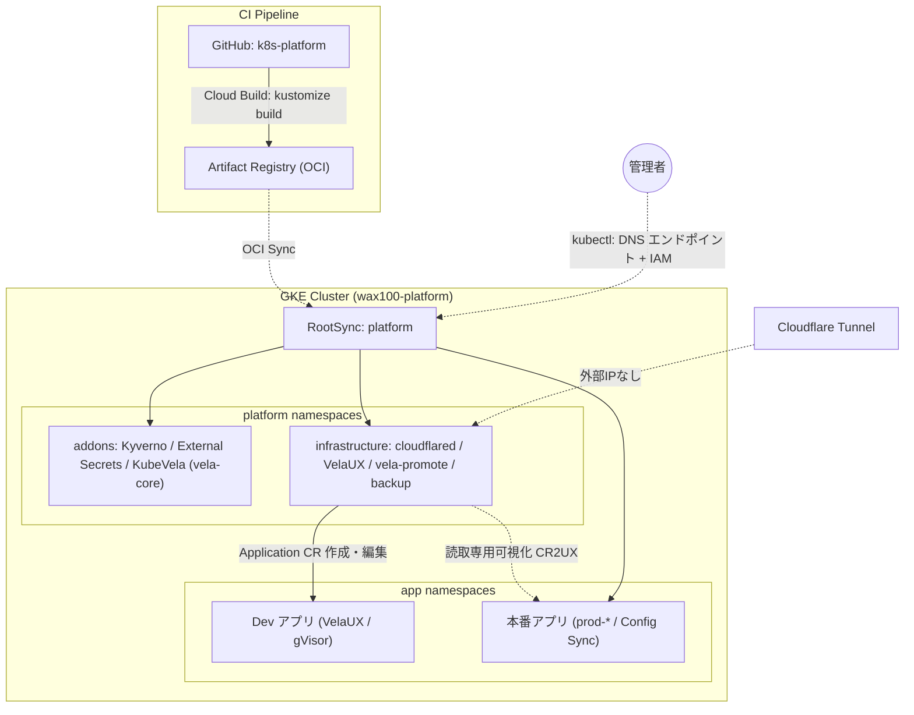

# GitOps Architecture Blueprint

このドキュメントは、本リポジトリが定義する GKE プラットフォームの全体構造と設計思想をまとめたものです。

**基本方針**: プラットフォーム基盤（アドオンとミドルウェア）および本番アプリ（`prod-*`）は Git と Config Sync が宣言的に管理し、開発環境（dev）のアプリケーションは **KubeVela + VelaUX**（Kubernetes ネイティブのアプリ配信コントロールプレーンと Web UI）で管理します。本番アプリも VelaUX 上で読取専用として可視化します。

## 1. 環境で分けた 2 つの真実の源

| 環境                 | 管理対象                                                       | 真実の源 (Source of Truth)                                            | 変更の入口        |
| :------------------- | :------------------------------------------------------------- | :-------------------------------------------------------------------- | :---------------- |
| **プラットフォーム** | Kyverno, External Secrets, cloudflared, KubeVela / VelaUX 本体 | 本 Git リポジトリ（OCI 経由で Config Sync が同期）                    | Pull Request      |
| **本番アプリ**       | `components/apps/<name>/`                                      | 同上                                                                  | 昇格 Pull Request |
| **dev / プレビュー** | VelaUX / KubeVela がデプロイする各アプリ                       | Kubernetes API（Dev Namespace の `Application` CR と `velaux-store`） | VelaUX の UI      |

**本番は GitOps、開発は VelaUX（KubeVela）** という分担です。GUI ベースの素早い開発体験を dev で享受しつつ、本番に出るものはすべて Git の差分としてレビューされます。

昇格は **初回だけ** dev の Namespace にラベルを付けます。

```bash
kubectl label ns <dev の Namespace> wax100.io/promote=true
```

`infra` Namespace の `vela-promote` CronJob がその Namespace の `Application` CR（および非所有の補助リソース）を取り出し、`components/apps/<app>/{base,overlays/production}`（VelaUX 連携用の `velaux-sync.yaml` を含む）に整形して Pull Request を立てます。マージすると Config Sync が `prod-<app>` へ同期し、**本番の Namespace は VelaUX からは変更できません**（状態・ログの閲覧のみ可能。後述の Admission 境界）。昇格ジョブの ServiceAccount（`infra/vela-promote`）も、Namespace に書けるのは Dev Namespace の `wax100.io/promote` ラベルだけです（`vela-promote-boundary` VAP）。

**dev と本番は同じクラスタの中で分けています。**

| 分け方    | dev                                                                                           | 本番                                                                                      | 仕組み                                                                                                                                                                 |
| :-------- | :-------------------------------------------------------------------------------------------- | :---------------------------------------------------------------------------------------- | :--------------------------------------------------------------------------------------------------------------------------------------------------------------------- |
| Namespace | VelaUX が作る（ラベル `usage.oam.dev/runtime=target`。名前は自由）                            | `prod-<app>`（Config Sync が作る）                                                        | `velaux-cluster-boundary` VAP・`velaux-namespace-boundary`（VelaUX は `prod-*` を作れない・変更できない）                                                              |
| 公開 URL  | `dev-<app>.wax100.io`（VelaUX で `gateway` / `ingress-1-20` トレイトを足したときだけ）        | `<app>.wax100.io`（dev に Ingress / gateway があるか `wax100.io/public=true` のとき自動） | ingress-nginx は共通。ホスト名は `ingress-hosts-by-environment` が縛る（dev は本番のホスト名を名乗れない）                                                             |
| 通信      | 同じ Namespace と ingress-nginx。ほかの dev Namespace と port-forward の中継 Pod からも受ける | 同じ Namespace と ingress-nginx からだけ受ける                                            | `environment-isolation`（NetworkPolicy を配る）。dev から本番の DB には届かない                                                                                        |
| 実行環境  | gVisor（GKE Sandbox。ノードは本番と共有）                                                     | 通常のコンテナ                                                                            | `run-dev-in-gvisor`（`clusterpolicy-dev-gvisor.yaml`、`autogen-controllers: none` で Pod CREATE のみ注入）。dev が破られても gVisor を越えないとノードや本番に届かない |
| kubectl   | コンテキスト `wax100-dev`（dev だけ編集。`velaux-store` と Secret は不可視）                  | コンテキスト `wax100-prod`（閲覧だけ。`velaux-store` と Secret は不可視）                 | `hack/kubectl-contexts.sh`・`environment-access`・`wax100-cluster-view`                                                                                                |

dev は名前ではなく、VelaUX が Target 作成時に必ず付けるラベル `usage.oam.dev/runtime=target`（かつ `app.kubernetes.io/managed-by` が未設定）で見分けます。名前は自由ですが、`dev-<app>` にしておくと dev と本番の対応が分かりやすくなります。本番の `<app>` は dev の Namespace 名から先頭の `dev-` を外したもの（1〜49 文字、`tg-local-prod-<app>` が DNS-1123 上限の 63 文字に収まる範囲）になります。

**2 回目以降はラベルが要りません。** 一度 `components/apps/` に載ったアプリは、ジョブが毎時 dev の状態を見に行き、差分があれば自動で追従 PR を立てます。同じアプリの PR が開いている間は新しい PR を立てないため、PR が乱立することもありません。

昇格 PR には、生成物に加えて **やるべき作業が本文に列挙されます** — 公開 URL、Secret Manager に登録が必要なシークレット ID の一覧、PVC がある場合の警告。

この分担が成立する鍵は、**同じリソースを二人の管理者が奪い合わない**ことです。Config Sync は Git を正としてドリフトを修正するため、VelaUX から本番 Namespace を直接編集できると衝突が発生します。本構成では API サーバー組み込みの `velaux-cluster-boundary` VAP と Kyverno の `velaux-namespace-boundary` が、Config Sync 管理下・`prod-*` への VelaUX からの書き込みを Admission で拒否します。同時に、`pj-production`（`components/infrastructure/velaux/base/production-project.yaml`）と昇格時に生成される `velaux-sync.yaml`（`tg-local-prod-<app>`・`ev-prod-<app>`）によって、VelaUX の `CR2UX` 機能が `prod-<app>` の `Application` を **書き込みゼロの読取専用** で `Production (GitOps Read-Only)` プロジェクトに表示します。

> RBAC には「この Namespace 以外で許可する」という除外の表現がありません。VelaUX は Dev Target ごとに Namespace を動的に使うため、許可リスト方式では新規 Dev 環境の作成が壊れます。そのため Dev 向けの基本操作を最小限の RBAC で残しつつ、API サーバー組み込み VAP と Kyverno の 2 段で境界を引いています。

なお dev 側の定義（`Application` CR・非所有補助リソース）と VelaUX データストア（`velaux-store` の ConfigMap 一式）は Git に入らないため、`infra/manifest-backup` が毎日 restic のリポジトリ（GCS）へ暗号化バックアップしています（Config Sync 管理下 = 昇格済みの Namespace は除外）。



## 2. 技術スタック

| コンポーネント                   | 採用技術                                            | 設計意図                                                                                                                                                                |
| :------------------------------- | :-------------------------------------------------- | :---------------------------------------------------------------------------------------------------------------------------------------------------------------------- |
| **GitOps 同期**                  | Config Sync (OCI モード)                            | リポジトリ認証情報をクラスタに置かず、Artifact Registry から GCP ネイティブ権限で Pull する                                                                             |
| **マニフェスト定義**             | Kustomize (base / overlays)                         | 上流 Helm チャートを `helmCharts` で取り込み、差分だけをパッチで表現する                                                                                                |
| **PaaS コントロールプレーン**    | KubeVela (`vela-core` 1.11.1) + VelaUX (`v1.9.5`)   | シングルクラスタ・外部 DB レスで厳選 43 定義を提供。Dev は GUI 編集、本番は GitOps + 読取専用可視化                                                                     |
| **コントロールプレーン永続化**   | Kubernetes API (`velaux-store` Namespace ConfigMap) | 外部 Cloud SQL 不要（コスト `$0`）。`velaux-store` は Secret 相当として隔離し、`manifest-backup` で毎日暗号化バックアップ。アプリの DB はクラスタ内に配置               |
| **機密情報管理**                 | External Secrets Operator + Secret Manager          | リポジトリに平文の機密を置かない。`cloudflared`・`vela-promote`・`restic`・本番アプリ（`prod-*`）が ESO 経由                                                            |
| **ミューテーション**             | Kyverno                                             | イメージを GAR のリモートキャッシュへ書き換え（レート制限回避、ベストエフォート）、アプリを `apps-pool` へ、Dev を gVisor へ、Config Sync を `platform-pool` へ振り分け |
| **外部公開**                     | Cloudflare Tunnel + ingress-nginx                   | 外部ロードバランサを持たない。`*.<domain>` を 1 ルールで nginx に流し、アプリは Ingress を持つだけで公開される                                                          |
| **監視**                         | GKE 標準の `logging_config` / `monitoring_config`   | 自前の Prometheus を運用せず、`SYSTEM_COMPONENTS` と `WORKLOADS` のログ（dev の通常ログは除外フィルタで無料枠内に維持）・メトリクスとバックアップ失敗アラートを使う     |
| **Secret の再読込**              | Reloader (stakater)                                 | ESO が `infra` Namespace の Secret を更新したとき、対象 Deployment を自動で rollout restart する                                                                        |
| **アクセス制御**                 | Cloudflare Access (Terraform で宣言)                | VelaUX UI・Headlamp・Backrest を許可メールアドレスに限定。管理画面を素で公開しないため                                                                                  |
| **コントロールプレーンへの到達** | DNS ベースエンドポイント + IAM                      | 外部 IP エンドポイントは無効。踏み台も VPN も持たず、認可は `container.clusters.connect`。クラスタの状態に依存しないため締め出しが起きない                              |

### 2.1 固定しているバージョン

上げるときはここを見てください。`_result.json` の差分にレンダリング結果が現れます。

| 対象                                           | バージョン                                 | 置き場所                                                           |
| :--------------------------------------------- | :----------------------------------------- | :----------------------------------------------------------------- |
| Config Sync                                    | 1.25.0                                     | `terraform/gitops.tf`                                              |
| KubeVela (`vela-core`) チャート                | 1.11.1 + digest 固定                       | `addons/kubevela/base`                                             |
| VelaUX イメージ                                | v1.9.5 + digest 固定                       | `components/infrastructure/velaux/base/deployment.yaml`            |
| 共通ユーティリティ (`ruby` / `alpine/kubectl`) | `3.4.13-bookworm` / `1.35.4` + digest 固定 | `backup`・`vela-promote` の 2 か所で共通固定                       |
| cloudflared                                    | 2026.9.1 + digest 固定                     | `components/infrastructure/cloudflared/base/cloudflared.yaml`      |
| pgvector（PG 18 拡張用）                       | 0.8.7-pg18-trixie + digest 固定            | `addons/kyverno/base/configmap-postgres-extensions.yaml`           |
| alpine/socat（中継 Pod）                       | 1.8.1.3 + digest 固定                      | `hack/dev-port-forward.sh`                                         |
| ingress-nginx チャート                         | 4.15.1                                     | `components/infrastructure/nginx-ingress/base`                     |
| Kyverno チャート                               | 3.9.1                                      | `addons/kyverno/base`                                              |
| External Secrets チャート                      | 2.10.0                                     | `addons/external-secrets/base`                                     |
| Reloader チャート                              | 2.2.17                                     | `addons/reloader/base`                                             |
| Headlamp チャート                              | 0.45.0                                     | `addons/headlamp/base`                                             |
| restic / rest-server                           | 0.19.1 / 0.14.0 + digest 固定              | `components/infrastructure/backup/base` の `images`（ここだけ）    |
| Backrest                                       | v1.14.1 + digest 固定                      | 同上                                                               |
| kustomize / helm                               | 5.8.1 / 4.3.0                              | `cloudbuild.yaml`（GitHub Actions も同版に固定）                   |
| kubeconform / yq                               | 0.8.0 / 4.53.6                             | `.github/workflows/ci.yml` / `hydrate.yml` / `cloudbuild.yaml`     |
| cargo-make / Prettier                          | 0.37.24 / 3.10.1                           | `.github/workflows/ci.yml` / `hydrate.yml` / `format-and-lint.yml` |
| Terraform（CI 検証）                           | 1.11.4                                     | `.github/workflows/ci.yml`                                         |
| Terraform プロバイダ                           | google 8.x / cloudflare 5.x / random 3.9.x | `terraform/providers.tf`                                           |

**プラットフォーム上の全コンテナイメージ（KubeVela・VelaUX・共通ユーティリティ・Kyverno・External Secrets・Reloader・Headlamp・ingress-nginx・cloudflared・バックアップ基盤・pgvector・socat）は digest で固定しています。** 各 `kustomization.yaml` の `images` 等で `<タグ>@sha256:<digest>` と書いています（タグは上流で付け替えられるため）。共通ユーティリティ（`ruby` と `alpine/kubectl`）は `backup` と `vela-promote` の **2 か所**（描画済み CronJob 5 本）で一致させ、digest 欠落・タグずれ・食い違いは `hack/check-backup-consistency.sh` が一括検出します。

**External Secrets は 2.x で API が `external-secrets.io/v1` になりました。** `v1beta1` は
CRD に残っていますが `served: false` です。昇格ジョブが生成する ExternalSecret も
`v1` を出力します。

**kustomize は 5.8.0 から、helm が生成したリソースに top-level の `namespace:` トランスフォーマが
効かなくなり、また top-level の `namespace:` はクラスタスコープの CRD / Webhook にも `metadata.namespace` を付けて Config Sync の `KNV1052` を引き起こします。** `addons/kubevela/base`・`components/infrastructure/velaux/base`・`addons/reloader/base` 等では top-level `namespace:` を置かず、`helmCharts[].namespace` と各マニフェストへの明示的な `metadata.namespace` を使い、さらに `hack/check-backup-consistency.sh` で全 18 kustomization のクラスタスコープリソースを検査しています。

## 3. リポジトリ構造

```text
addons/                      クラスタ全体に効くシステムコンポーネント
├── external-secrets/        base + cluster-resources (ClusterSecretStore)
├── kubevela/                base (vela-core 1.11.1 + 厳選 43 定義 + 最小権限 RBAC + Webhook/Egress NetworkPolicy)
├── kyverno/                 base (レジストリ書き換え / アプリ振り分け / 境界 / ホスト隔離の ClusterPolicy と 6 VAP)
├── reloader/                base (infra の Secret 更新時の自動 rollout restart)
└── headlamp/                base (ダッシュボード。dashboard.wax100.io、Access 保護。操作できるのはアプリ Namespace とバックアップ CronJob の実行・一時停止だけ)

components/apps/             本番アプリ (昇格 PR が追記する)
└── kustomization.yaml       昇格済みアプリの一覧

components/infrastructure/   プラットフォーム・ミドルウェア
├── backup/                  DB ダンプ・dev アプリ定義・velaux-store・本番 PVC を毎日 restic で送る一式（docs/BACKUP.md）
├── cloudflared/             base (system-pool / 1 本)
├── dev-access/              dev の DB 等への port-forward 用中継 Namespace・RBAC・NetworkPolicy（hack/dev-port-forward.sh）
├── namespaces/              複数コンポーネントが相乗りする Namespace (infra)
├── nginx-ingress/           base (ClusterIP。cloudflared からの唯一の入口 / system-pool / 1 本)
├── vela-promote/            base (Namespace infra で動く昇格 CronJob。dev → 本番 PR 生成 + velaux-sync.yaml)
├── velaux/                  base + overlays/production (VelaUX v1.9.5 + velaux-store + pj-production + 8 VelaQL ビュー + 14 UI スキーマ)
└── vpa-recommendations/     プラットフォーム部品の requests 見直し用 VPA（updateMode: Off）

clusters/platform/           Config Sync が同期する単位。Cloud Build が OCI 化する
bootstrap/                   人が 1 回だけ kubectl apply するもの (RootSync)
terraform/                   GKE / ノードプール / VPC / Secret Manager / restic 用バケット / Cloudflare / Config Sync / 監視アラート
docs/                        本ドキュメント群
```

各コンポーネントは `base/`（環境非依存）と `overlays/<env>/`（環境差分）に分かれます。単一クラスタ構成のため現在の overlay は `production` のみです。

## 4. ノードプール設計

| プール          | 種別        | マシン                                           | スケール | taint                                                                  | 用途                                                                                                                |
| :-------------- | :---------- | :----------------------------------------------- | :------- | :--------------------------------------------------------------------- | :------------------------------------------------------------------------------------------------------------------ |
| `system-pool`   | **通常 VM** | e2-medium（`system_pool_machine_type`）          | 1〜3     | なし                                                                   | kube-system、**cloudflared ×1、ingress-nginx ×1**                                                                   |
| `platform-pool` | Spot        | e2-custom-2-4096（`platform_pool_machine_type`） | 1〜3     | `gke-spot:NoSchedule`                                                  | KubeVela / VelaUX, **Config Sync**, Kyverno, ESO, Reloader, Headlamp, Backrest, rest-server, 昇格・バックアップ Job |
| `apps-pool`     | Spot        | e2-medium（可変）                                | 0〜3     | `gke-spot:NoSchedule` + GKE Sandbox の `sandbox.gke.io/runtime=gvisor` | KubeVela がデプロイするアプリ（dev と本番）                                                                         |

### プールの役割分け

- **system** — ネットワークを動かすのに最低限必要で、**停止を許容できない**もの。外からの唯一の入口である cloudflared と ingress-nginx もここに 1 本ずつ置く。Spot に置くと回収 1 回でアプリも VelaUX UI も外から見えなくなるため。必須の anti-affinity と PDB は外し、平常時は 1 台に収める（ノード更新時はサージ更新で新しいノードが先に立ってから移る）。ingress-nginx にはリソース上限を付け、インターネットからの負荷が同じノードの GKE のシステム Pod を圧迫しないようにしている。クラスタ内の名前解決は Cloud DNS for GKE に任せ、kube-dns は 0 本にしている（kube-dns は CPU 540m を要求し、e2-medium の system-pool が増えて減らなくなるため。確認手順は [GKE_SETUP_GUIDE.md](GKE_SETUP_GUIDE.md) の 8.10）
- **platform** — メトリクスや GitOps、KubeVela / VelaUX など、止まっても数分で戻れば済むもの。**Config Sync もここ**。GKE が入れる Config Sync の Pod は nodeSelector も toleration も持たず、そのままだと taint の無い system-pool に載るため、Kyverno（`pin-config-sync-to-platform-pool`、`failurePolicy: Ignore`、`autogen-controllers: none`）が Pod の作成時に platform-pool 行きを注入する。Kyverno が居ない間（クラスタ作成直後など）は注入されず system-pool に載るので、Config Sync が Kyverno に依存して起動できなくなることはない。Google の公式手順は同じことを MutatingAdmissionPolicy（Kubernetes 1.36 以上）で行うもので、STABLE チャンネルに 1.36 が来たら置き換える
- **入口の優先度** — cloudflared と ingress-nginx には PriorityClass `platform-ingress`（1000000）を付けている。既定の 0 のままだと、system-pool のメモリが足りなくなったとき真っ先に追い出される。GKE の system-cluster-critical（2000000000）よりは下にして、GKE のシステム Pod は押しのけない。アプリの Pod が `priorityClassName` を指定すると、本番の Pod を追い出せるため Kyverno の `restrict-app-host-access` が拒否する
- **apps** — KubeVela が動かすアプリ（dev と本番）。dev と本番はノードを分けず、Namespace・通信・kubectl のコンテキストで分け、dev は gVisor（GKE Sandbox）で動かす。ノードを分ける（費用が増える）代わりに、dev のコンテナとノードの間にもう 1 段のカーネルを挟む

**Kyverno が止まっても入口は止まらない。** イメージ書き換えのポリシー（`artifact-registry-mirror`）はほぼ全 Pod にかかるが、`failurePolicy: Ignore` にしてある。書き換えはレート制限を避けるための最適化で、セキュリティ上の統制ではないため。Kyverno が落ちている間は上流から直接取得する。`Fail` のポリシー（apps への固定、dev の gVisor 隔離、ホスト到達の拒否、VelaUX / `vela-core` の境界）には `webhookConfiguration.matchConditions` を付けている。Kyverno の Webhook は既定で `kube-system` と `kyverno` 以外の**全 Namespace**で呼ばれ、ポリシーの `exclude` は Kyverno の中でしか効かないため、これが無いと Kyverno が落ちている間は `infra`（入口）や `vela-system`・Config Sync の Pod まで作れなくなる。`matchConditions` があると Kyverno はポリシー専用の Webhook を作り、条件は API サーバーが評価するので、Kyverno が落ちていても対象外の Namespace は素通しになる（Kyverno v1.19 のソースで確認）。結果として、Kyverno が止まっている間は、`failurePolicy: Ignore` と書いた 2 つ（`artifact-registry-mirror` と `pin-config-sync-to-platform-pool`）以外のポリシーが対象にする作成・更新が拒否される。`failurePolicy` を書いていないポリシーは既定の `Fail` で動く。拒否されるのは、アプリの Pod の新規作成、Ingress や PVC の作成・更新、バックアップ Job の作成、DB の Pod への exec、ExternalSecret・SecretStore・PushSecret の作成・更新（`infra` 以外）などで、どのポリシーがどの Namespace を対象にするかは各 ClusterPolicy の `matchConditions` で決まる。既に動いている Pod は止まらない。

External Secrets の Webhook（`externalsecret-validate`、`failurePolicy: Fail`）も同じく 1 台で、platform-pool（Spot）に載っている。再起動中は ExternalSecret の作成・更新（Config Sync が適用するものを含む）が拒否される。

**プラットフォーム用のプールを 1 つにしている理由。** 以前は `xs`/`sm`/`md`/`lg` の
4 ティアに分け、Pod 側の nodeAffinity で振り分けていました。これをやめています。

Cluster Autoscaler は **「A プールを空けるために B プールを増やす」ことをしません**。
縮退の判定は「**今あるノード**に載せ替えられるか」だけで行われます。最小 0 台の
プールが複数並んでいると、いったん各プールに散った Pod を寄せ直す経路が存在せず、
Spot の回収でプールが入れ替わるたびにノードが増える一方になります。結果として
**全プールが上限に張り付いたまま戻らない**状態に陥ります。

プールを 1 つにすれば同一プール内で自由に載せ替えられるため、素直に縮退します。
`vela-core`（100m / 128Mi）と `velaux-server`（50m / 128Mi）を含めても常駐 Pod の要求合計は概ね cpu 650m〜700m / memory 1.3Gi〜1.5Gi で、`e2-custom-2-4096`
（cpu 2 / memory 4Gi）なら通常時 1 台に収まります。Pod 側は
`nodeSelector: workload-type=platform` と Spot の toleration だけを持ち、
ティアを指定する nodeAffinity は持ちません。

KubeVela（`Application`）が生成する Pod は nodeSelector も toleration も持ちません。そのままでは taint のない `system-pool` に載ってしまい、GKE のシステムコンポーネントとアプリが同居します。逆に `apps-pool` を Spot の taint で保護すると、今度はアプリがどこにも載らなくなります。

そこで **Kyverno の ClusterPolicy `pin-apps-to-apps-pool`** が、アプリ用 Namespace の Pod に Admission 時点で次を注入します。

- `nodeSelector: workload-type=app`。**上書き**で、アプリ側の指定は尊重しない（尊重すると、アプリが `workload-type: system` と書くだけで taint の無い system-pool に載れてしまうため）
- `cloud.google.com/gke-spot`・GKE Sandbox・Kubernetes 標準の 300 秒 `NoExecute` の toleration

結果として、アプリ（dev も本番も）は **Spot の `apps-pool` にのみ載り、`system-pool` と `platform-pool` からは締め出されます**。除外対象は GKE のシステム Namespace（`kube-system`, `gke-*`, `gmp-*` など）、Config Sync の Namespace、本リポジトリが管理する `vela-system` / `velaux-store` / `infra` / `external-secrets` / `kyverno` / `reloader` / `headlamp` / `dev-access` です。

**Node Auto-Provisioning は無効化**しています（`cluster_autoscaling.enabled = false`）。有効のままだと、既存プールに収まらない Pod のために GKE が Spot ではない独自のノードプールを作りうるためです。

## 5. アプリの公開経路

```text
インターネット → Cloudflare (Access / WAF) → Tunnel → cloudflared Pod
   → ingress-nginx (ClusterIP) → Ingress のホスト一致 → アプリの Service
```

Cloudflare 側は**トンネル本体からルーティング・DNS まで Terraform が宣言**します
（`cloudflare-tunnel.tf`）。ダッシュボードでの手作業はありません。
ルーティングの実体は次のルールだけです。

| hostname              | 転送先        |
| :-------------------- | :------------ |
| `vela.wax100.io`      | VelaUX UI     |
| `dashboard.wax100.io` | Headlamp      |
| `backup.wax100.io`    | Backrest      |
| `*.wax100.io`         | ingress-nginx |
| （その他）            | 404           |

管理画面の 3 ルール（`vela.wax100.io`・`dashboard.wax100.io`・`backup.wax100.io`）にはすべて Cloudflare Access（`cloudflare-access.tf`）と cloudflared 側の JWT 検証（`origin_request.access`）が掛かり、`platform_admin_emails` や `cloudflare_access_team_name` が空のままではルーティングも DNS も `terraform apply` の precondition で止まります。
DNS もワイルドカード CNAME 1 件と管理画面の CNAME を Terraform が作ります。したがって**アプリを 1 つ増やすときに Cloudflare 側でやることは何もありません** — `Ingress` リソースが Git に入るだけで `https://<app>.wax100.io` が生えます。昇格ジョブは dev に Ingress / gateway トレイトがあるか、Namespace に `wax100.io/public=true` ラベルが付いている場合だけ本番用の Ingress を自動生成します（内部ワーカーや BOT の意図しない外部公開を防ぐため）。

ロードバランサは作らないため、この経路に固定費は発生しません。ingress-nginx は ClusterIP で、外部 IP も持ちません。

オリジンは Tunnel の内側で HTTP だけを話すため、HTTPS への転送・TLS 1.2 未満の拒否・HSTS は Cloudflare のエッジで効きます。これも `cloudflare-zone.tf` で Terraform が宣言しています（ゾーン全体に効くので、既定の `cloudflare_manage_zone_security = true` を外す前に、同じゾーンの他のサイトを確認すること）。

## 6. コンテナレジストリ・キャッシュ戦略 (Kyverno)

Docker Hub 等のレート制限を回避し、イメージ取得を高速化するため、イメージの取得を Google Artifact Registry のリモートリポジトリ・キャッシュ（`asia-northeast1`）へ向けます。これは**ベストエフォート**です（`failurePolicy: Ignore`）。Kyverno が止まっている間は書き換えずに上流から直接取得し、Pod の作成は止めません。

`kustomization.yaml` ごとに `images` トランスフォーマーを書くのではなく、**Kyverno の ClusterPolicy**（`addons/kyverno/base/clusterpolicy-registry-mirror.yaml`）で Pod 作成時（`CREATE` のみ）に書き換えます。

- `docker.io/` → `asia-northeast1-docker.pkg.dev/<PROJECT_ID>/docker-hub-cache/`
- `ghcr.io/` → `.../ghcr-cache/`（Kyverno・Reloader・Headlamp 等もここを通ります）
- `quay.io/` → `.../quay-cache/`
- `registry.k8s.io/` → `.../k8s-cache/`
- `nginx:1.27`（レジストリもユーザー名も無い公式イメージ）→ `.../docker-hub-cache/library/nginx:1.27`
- `bitnami/redis:7`（レジストリ省略）→ `.../docker-hub-cache/bitnami/redis:7`

最後の 2 つが重要です。KubeVela / VelaUX がデプロイするアプリや一般的な Helm チャートはレジストリを省略した書き方が大半で、接頭辞付きの参照しか書き換えないとレート制限回避という目的が最も必要な場面で効きません。先頭セグメントに `.` や `:` を含む参照（`registry.example.com/foo`、`localhost:5000/foo`）は対象外です。

各ルールは `containers` と `initContainers` の両方を走査します。foreach の対象は `request.object.spec.initContainers || []` のように**空配列で補って**います。補わないと `initContainers` を持たない Pod（= ほぼ全部）で評価エラーになり、書き換えが 1 件も行われません（`failurePolicy: Fail` だった頃は、この評価エラーで Pod の作成そのものが拒否されていました）。Kyverno CLI で実際の Pod に適用して、書き換わることを確認しています。

`gcr.io` はキャッシュしません（Google のレジストリで、レート制限の問題が無いため）。

**Kyverno 自身は書き換えの対象外です**: Kyverno は既定の `resourceFilters` で自分の Namespace（`kyverno`）と `kube-system` などを除外しているため、Kyverno 自身の Pod はこのポリシーを通りません。代わりにチャートの設定（`global.image.registry` と `webhooksCleanup.image.registry`）で、Kyverno のイメージをすべて `ghcr-cache` から取得するようにしています（`addons/kyverno/base/kustomization.yaml`）。

**注意**: この書き換えは KubeVela / VelaUX がデプロイするアプリの Pod にも適用されます。ユーザー自身のプライベートレジストリを使う場合は、そのレジストリが書き換え対象に含まれないことを確認してください。

## 7. セキュリティ上の論点

- **VelaUX と KubeVela の 2 段境界（RBAC + VAP + Kyverno）**:
  - `kubevela-ux`（`velaux-server`）: `cluster-admin` は付与せず、クラスタ全体の Secret 読取権限も持ちません（`velaux-minimal` + `velaux-store-datastore` + `velaux-vela-system`）。`kubevela:writer` / `kubevela:writer:application` / `kubevela:writer:binding` を宣言的に事前作成して `ClusterRoleBinding` の書き込み権限を除去し、API サーバー組み込み VAP **`velaux-cluster-boundary`**（3 つの運用例外のみ許可・Dev Namespace 制約・`RoleBinding` の 4 不変条件で `bind` 自己昇格を遮断・特権 26 API グループ / Secret / NetworkPolicy / CONNECT を禁止）と Kyverno **`velaux-namespace-boundary`** で 2 段防御します。VelaUX UI へのアクセス制御（`terraform/cloudflare-access.tf` の `platform_admin_emails` + VelaUX 認証）と併せて多層防御しています。
  - `kubevela-vela-core`（コントローラ）: 上流チャートの `cluster-admin` バインディングを `op: test` ガード付きパッチで最小権限 `kubevela-vela-core:manager` に置換し、API サーバー組み込み VAP **`vela-core-cluster-boundary`**（基盤 Namespace・`velaux-store`・RBAC・VAP・Kyverno・ESO・NetworkPolicy・DaemonSet・CRD・Node・PV・CONNECT の書き込み禁止）と **`vela-application-guard`**（主体非依存で `addons/kubevela/base/definitions/` の厳選 43 定義と 1:1 照合し、`k8s-objects`/`raw`/`ref-objects`/`vela-cli`/`apply-terraform-*`・`app.oam.dev/{service-account-name,username,group}`・`externalRevision`・`service-account` の `privileges`・他 Namespace `topology`・`inputs[]` 注入・Unicode / 大文字小文字回避キーを厳格拒否）と Kyverno **`vela-core-namespace-boundary`** で保護します。同梱の VelaQL ビュー（`components/infrastructure/velaux/base/views.yaml`）も 3 ビューをハードニングし、1 ビューを空スタブ化しています。
- **`velaux-store` の Secret 相当隔離**: `velaux-store` Namespace の ConfigMap には VelaUX の JWT 署名鍵（`sysi-*`）やユーザーの bcrypt ハッシュ（`usr-*`）が格納されるため、`wax100-dev`・`wax100-prod`・`headlamp-user` から標準の `ClusterRole/view` を完全撤去しました。代わりに `configmaps` と `secrets` を除外し `aggregationRule` を持たない `wax100-cluster-view` / `headlamp-user-view` と、アプリ Namespace（Dev / `prod-*`、`velaux-store` 除外）限定の ConfigMap 読取 RoleBinding（`wax100-app-cm-view` / `headlamp-user-prod-ops`）に分離しています。`velaux-store` 自体は PSS `enforce: restricted` + `velaux-store-deny-all` NetworkPolicy で全通信を遮断しています。
- **主体非依存のストレージ・ネットワーク・exec・昇格境界（API サーバー組み込み VAP）**:
  - `app-storage-network-boundary`（`addons/kyverno/base/validatingadmissionpolicy-app-storage-network-boundary.yaml`）: プラットフォーム系以外の全 Namespace で、危険なボリューム（`hostPath`〔例外なし〕・`gcePersistentDisk`・`csi`・`nfs`・`local`・`flexVolume`・不正 `ephemeral`）、`storageClassName: manual` / `volumeName` / `dataSource` を含む PVC と `StatefulSet.volumeClaimTemplates[]`、`type: ExternalName` / `externalIPs` の Service、手動 `Endpoints` / `EndpointSlice` を主体非依存で一律拒否します（`kubevela-vela-core` もアプリ Namespace では対象）。
  - `db-backup-exec-boundary`（`addons/kyverno/base/validatingadmissionpolicy-db-backup-exec-boundary.yaml`）: `system:serviceaccount:infra:db-backup` の `pods/exec` を、プラットフォーム系 Namespace 以外（`kube-*`・`infra`・`vela-system`・`velaux-store`・`kyverno` 等への exec 禁止）かつ空コンテナ名なしに API サーバー側で強制します（Kyverno の `db-backup-exec-scope` と 2 段防御）。
  - `vela-promote-boundary`（`addons/kyverno/base/validatingadmissionpolicy-vela-promote-boundary.yaml`）: `system:serviceaccount:infra:vela-promote` の Namespace patch を Dev Namespace の `wax100.io/promote` ラベルのみに限定します。
- **dev と本番の通信を分ける**: Kyverno の `environment-isolation` が dev（`usage.oam.dev/runtime=target`）と `prod-*` に NetworkPolicy（`environment-isolation`・`dev-access-relay`・`dev-to-dev`）を配り、Pod への着信を同じ Namespace と ingress-nginx からだけに絞ります（dev は、ほかの dev Namespace と port-forward の中継 Pod からも受けます）。dev のアプリから本番の DB や Redis には届きません。外向き通信は制限せず宛先側の Ingress NetworkPolicy で分離しています。本番でアプリ同士をつなぐときは、その本番の overlay に NetworkPolicy を足して許可します。
- **管理画面・入口・Webhook・バックアップ基盤の NetworkPolicy 多層化**: Cloudflare Access は外からの経路しか守りません。`vela-system`（`vela-system-deny-all-ingress` + `velaux-allow-from-cloudflared` で `:8000` のみ `infra/cloudflared` から許可 + `vela-core-allow-webhook` で `:9443` のみコントロールプレーンとノードサブネットから許可 + `vela-core-egress-restrict` + `velaux-egress-restrict`）、`velaux-store`（`velaux-store-deny-all`）、Headlamp（`addons/headlamp/base/networkpolicy.yaml`）、ingress-nginx（`components/infrastructure/nginx-ingress/base/networkpolicy.yaml`）への着信を最小限に絞っています。さらに `kyverno`（TCP `9443`）・`external-secrets`（TCP `10250`）・`reloader`（全着信拒否）にも Ingress NetworkPolicy を置き、コントロールプレーン（`172.16.0.0/28`）とノードサブネット（`10.0.0.0/22`）以外の Pod からの Webhook DoS を防いでいます。外向き通信も `cloudflared`・`ingress-nginx`・`vela-core`・`velaux-server`・`vela-promote`・`backrest`・`pvc-backup-mover`・`manifest-backup` に Egress NetworkPolicy を設定し、必要最小限の宛先（対象 Service・DNS・コントロールプレーン API・外部 HTTPS / Tunnel）以外への横移動・データ持ち出しを遮断しています。NetworkPolicy を実際に効かせるため、クラスタは Dataplane V2（`datapath_provider = "ADVANCED_DATAPATH"`）で作ります（作成後は変更不可。各ノードに anetd の DaemonSet が載ります）。
- **ESO・Reloader・Kyverno の RBAC 最小化**: ESO は基盤シークレットごとに `google_secret_manager_secret_iam_member` を個別に付与し（GCP IAM Condition の論理演算子上限を回避。`cloudflare-api-token` は対象外）、本番アプリ用のみ `prod-*` 接頭辞の IAM 条件を付与しています。ESO 側では `rbac.serviceAccountTokenCreate: false`・`processSecretStore: false`・`edit`/`view` への非集約を設定し、`ClusterSecretStore` の `conditions`（`infra` / `prod-*`）と Kyverno の `externalsecret-scope-by-namespace`（`prod-<app>_` 接頭辞強制）で多層保護します。Reloader は `watchGlobally: false`（`infra` のみ監視）＋ `ignoreJobs`/`ignoreCronJobs: true` ＋ Job/CronJob 権限パッチ除去で最小権限化し、Kyverno も `rbac.roles.aggregate.admin: false`・`backgroundController` の不要権限削除・`cleanup-controller` の Namespace 限定 `Role` 化を行っています。
- **アプリ Pod からホストへの到達を禁止**: `apps-pool` には KubeVela / VelaUX 経由で利用者が投入した任意のコンテナが載ります。Kyverno の `restrict-app-host-access` が hostNetwork / hostPID / hostIPC / 危険なボリューム（`hostPath`・`gcePersistentDisk`・`csi`・`nfs`・`local`・`flexVolume`）/ hostPort / 特権コンテナ / Baseline PSS 違反（安全でない `sysctls`・`seLinuxOptions`・`Unconfined` な `appArmorProfile`・`Unmasked` な `procMount`・`Unconfined` な `seccompProfile`）/ 危険な capability（`SYS_ADMIN`・`NET_ADMIN`・`NET_RAW`・`DAC_OVERRIDE` など）/ `spec.nodeName`・`priorityClassName` の直接指定を拒否します（ephemeralContainers も対象）。seccomp を書かなかった Pod には `pin-apps-to-apps-pool` が `RuntimeDefault` を入れます（書かれないと Unconfined で動くため）。ノードも既定の Compute Engine SA ではなく、ログ・メトリクス・イメージ取得だけを持つ専用 SA（`gke-node`）で動かし、セキュアブートを有効にしています。両方が揃って初めて「メタデータサーバ経由でノードの権限を奪う」経路が塞がります。
- **kubeconfig を保存しない**: `vela-core`・`velaux-server` ともシングルクラスタ・in-cluster ServiceAccount で動作するため、外部クラスタの kubeconfig や静的認証情報を保持しません。
- **Private クラスタ + Cloudflare Tunnel**: 外部 IP を持たず、インバウンドは Cloudflare からのトンネル経由のみです。
- **コントロールプレーンの IP エンドポイントは内部のみ**: `private_control_plane_only = true` で外部 IP エンドポイントを無効化しています。`master_authorized_cidrs` の既定は空で、IP 経由で外から触ることはできません。
- **管理者の `kubectl` は DNS ベースエンドポイント + IAM**: 認可はネットワークではなく IAM（`container.clusters.connect`）で行います。**この口はクラスタの中身に依存しない**ため、cloudflared が落ちていてもノードが 0 台でも到達でき、踏み台・VPN・WARP をどれも必要としません。CI からも同じ経路をサービスアカウントで使えます。
  - 代償として、守りは IAM 1 枚になります。Google アカウントの 2 段階認証の強制と、`container.clusters.connect` を持つプリンシパルを絞ることが実質的な防御線です。境界が必要なら VPC Service Controls を被せ、`enable_dns_endpoint_external = false` にして VPC 内部からのみ到達させます。
