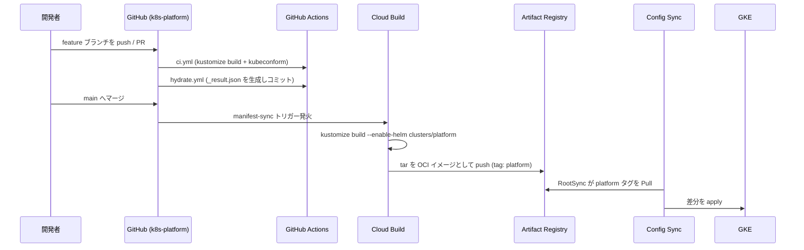
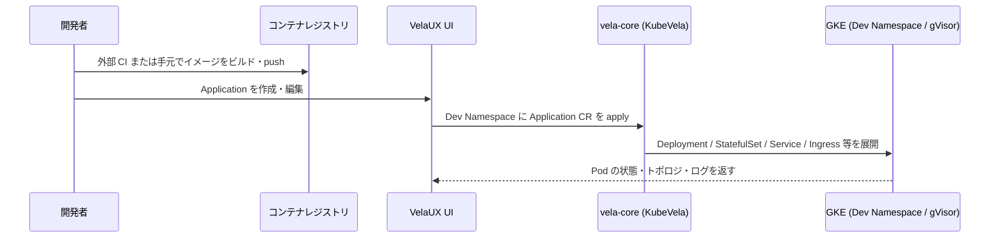
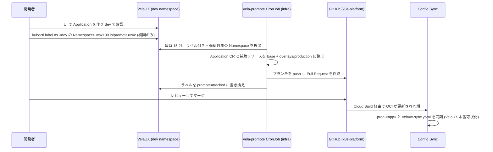

# デプロイメント＆リリースフロー

本プラットフォームは **本番を GitOps、開発を KubeVela / VelaUX** で分担します。どの経路を通るかは「何を、どの環境に変更するか」で決まります。

| 変更対象                                                                | 経路                                                         | 所要時間の目安         |
| :---------------------------------------------------------------------- | :----------------------------------------------------------- | :--------------------- |
| プラットフォーム基盤（アドオン / ミドルウェア / KubeVela・VelaUX 自身） | Git → Cloud Build → Artifact Registry (OCI) → Config Sync    | 数分                   |
| **本番アプリ**                                                          | `components/apps/` への PR → Cloud Build → Config Sync       | 数分                   |
| dev / プレビューのアプリ                                                | コンテナイメージ → VelaUX UI（`Application` 作成・デプロイ） | 数分                   |
| dev → 本番の初回昇格                                                    | Namespace にラベル → 昇格 PR → レビュー → マージ             | 最大 1 時間 + レビュー |
| 昇格済みアプリの追従                                                    | dev を更新するだけ → 自動で追従 PR → レビュー → マージ       | 最大 1 時間 + レビュー |

## 1. プラットフォーム変更のフロー



### 1.1 ローカルでの事前検証

> `cargo make` と `hack/*.sh` は `bash` / `ruby` / `jq` を前提としているため、macOS・Linux・WSL または Cloud Shell の bash で実行してください。

```bash
cargo make validate    # kustomize build + kubeconform + hack/check-backup-consistency.sh
cargo make hydrate     # _result.json を再生成
cargo make pre-commit  # 上記 2 つをまとめて実行
```

`_result.json` は「Config Sync が最終的にクラスタへ送る API オブジェクト」のスナップショットです。PR の差分として現れるため、Helm チャートのバージョンを上げたときに**実際に何が変わるのか**をレビューできます。

### 1.2 CI で走るもの

| ワークフロー          | 内容                                                                                                                                                                                |
| :-------------------- | :---------------------------------------------------------------------------------------------------------------------------------------------------------------------------------- |
| `ci.yml`              | 全 `kustomization.yaml` の `kustomize build` + `kubeconform -strict`、`check-backup-consistency.sh`、`ruby -c`、`terraform validate`、`_result.json` 鮮度検証                       |
| `hydrate.yml`         | `_result.json` を再生成（削除済みコンポーネントの残留ファイルも除去）し、差分があれば PR ブランチへコミットして `ci.yml` / `format-and-lint.yml` / `secret-scanning.yml` を起動する |
| `format-and-lint.yml` | Prettier と Super-Linter（`yamllint` / `markdownlint` / `actionlint` / `shellcheck` / `terraform fmt`）による整形・構文チェック（自動では直さない）                                 |
| `secret-scanning.yml` | TruffleHog / gitleaks による機密情報スキャン（全ブランチの push および PR）                                                                                                         |

### 1.3 Config Sync の適用

`bootstrap/root-sync.yaml`（ブートストラップ時に手で 1 回適用する）が OCI イメージの `platform` タグを監視します。Cloud Build が新しいタグを push すると、RootSync が自動的に差分を取り込みます。

デプロイ順序は `config.kubernetes.io/depends-on` アノテーションで制御しています（Namespace や CRD には付けず、必要な Deployment・Definition・ExternalSecret に限定しています）。

1. **Kyverno**（`addons/kyverno`）— 後続 Pod のイメージ書き換えと Admission 検査を確実に行うため最優先（`global.crdWatcher: true` により CRD 追加にも自動追従）
2. **External Secrets・KubeVela の Deployment**（`addons/external-secrets`・`addons/kubevela`）— Kyverno の Admission Controller に依存（CRD と Namespace は先行適用される）。KubeVela の厳選 43 定義は `kubevela-vela-core` に依存し、`velaux-server` は Kyverno Admission Controller と `kubevela-vela-core` に依存
3. **各 ExternalSecret**（`cloudflared` / `vela-promote` / `backup` / 本番アプリ）— External Secrets の Deployment と `ClusterSecretStore/gcp-secret-store` に依存（`cloudflared` Deployment 本体は依存に含めない）

### 1.4 ロールバック

Config Sync は Git（正確には OCI タグ）の状態に追従します。`git revert` して main に戻せば、Cloud Build が再ビルドし、クラスタも元に戻ります。緊急時は Artifact Registry 上の以前の `platform-<COMMIT_SHA>` タグを `platform` に付け替えることで、Git を待たずに巻き戻せます。

## 2. dev / プレビューのフロー (KubeVela / VelaUX)

dev 環境のアプリ定義は本リポジトリには存在せず、VelaUX の UI（Dev Namespace 内の KubeVela `Application` CR）で管理します。本番へ出すときは後述の昇格フローを通ります。

**Namespace の名前は自由です**（`prod-` やプラットフォーム基盤の予約名は `velaux-cluster-boundary` VAP と `velaux-namespace-boundary` が拒否します）。
dev かどうかは名前ではなく、VelaUX が Target 作成時に付けるラベル `usage.oam.dev/runtime=target`（かつ `app.kubernetes.io/managed-by` が未設定）で見分けます。
本番は、dev の Namespace 名から先頭の `dev-` を外した `prod-<app>` になります（1〜49 文字、`dev-<app>` 命名を推奨）。
dev のアプリは本番と同じ `apps-pool` に載りますが、gVisor（GKE Sandbox）の中で動き、本番の Namespace とは通信できません（dev 同士は通信できます）。gVisor では hostPath・privileged・`kubectl port-forward` が使えませんが、永続ストレージは KubeVela の `storage` / `pvc` トレイトでクラスタ既定の Persistent Disk（`standard-rwo`）を直接使い、port-forward は `hack/dev-port-forward.sh` が dev の外（Namespace `dev-access`）に作る gVisor 無しの中継 Pod 経由で行います。dev の Pod は例外なく gVisor で動き、中継 Pod から本番には繋がりません。hostPath と privileged は、もともとアプリには許していません（[ARCHITECTURE.md](ARCHITECTURE.md) の 1 章）。

```bash
bash hack/dev-port-forward.sh <dev の Namespace> <Service> <ポート>   # 例: dev-myapp postgres 5432
```



### 2.1 コンテナイメージと Application 定義

アプリのコンテナイメージのビルドは GitHub Actions / Cloud Build 等の外部 CI または手元で行い、Docker Hub・GHCR・Artifact Registry 等へ push します。VelaUX では厳選された 5 種の ComponentDefinition（`webservice`, `worker`, `task`, `cron-task`, `statefulset`）と 25 種の TraitDefinition から宣言的にデプロイします。クラスタ内に特権ビルダーを持たないため、攻撃面・常駐コストともにゼロです。詳細は [KUBEVELA_SETUP.md](KUBEVELA_SETUP.md) を参照してください。

### 2.2 公開

dev 環境のアプリは既定では外部公開されません。外から触りたい場合だけ、VelaUX の画面（`gateway` または `ingress-1-20` トレイト）でドメイン `dev-<app>.wax100.io` を足します（`dev-` で始まらないホスト名は Kyverno の `ingress-hosts-by-environment` が拒否します。本番のホスト名を dev が名乗って通信を横取りしないため）（`*.wax100.io` のルールが拾うので Cloudflare 側の作業は不要）。Cloudflare Access は掛からないので、必要なら Access のアプリを別途足してください。

ホスト名は必ず `wax100.io` の 1 階層下にします。Cloudflare の無料の証明書（Universal SSL）は 1 階層下までしか効かず、`<app>.dev.wax100.io` のような名前は HTTPS がつながりません。また、ゾーンに個別のレコードがある名前やプラットフォーム予約名（`vela`・`dashboard`・`backup`・`www`・`dev` など）はワイルドカードより優先されるため、アプリ名に使えません。

**本番に昇格したアプリはオプトインで外部公開されます。** dev に `Ingress` / `gateway` トレイトがあるか、dev の Namespace に `wax100.io/public=true` ラベルが付いている場合だけ昇格ジョブが本番用の `Ingress`（`https://<app>.wax100.io`）を生成します（内部専用のワーカーや BOT を誤って公開しないため）。`*.wax100.io` を ingress-nginx にまとめて流しているワイルドカードのルールが拾うため、Cloudflare 側の作業も DNS の追加も要りません。

### 2.3 ロールバック

dev 環境は VelaUX の UI（Application のリビジョン履歴 / Revision）からロールバックします。本番は `git revert` してマージすれば Config Sync が元に戻します。

### 2.4 アプリ定義のバックアップ

VelaUX のデータストア（`velaux-store`）および Dev Namespace の `Application` CR・補助リソースは、`infra/manifest-backup` が日次で restic のリポジトリ（タグ `manifests`・`velaux-store`。Backrest の `https://backup.wax100.io` で見られる）へ暗号化バックアップしています（dev のマニフェストに Secret は含みません）。

## 3. 昇格フロー (dev → 本番)



### 3.1 生成されるもの

```text
components/apps/<app>/
├── base/
│   ├── kustomization.yaml
│   ├── application.yaml          # サニタイズ済み KubeVela Application CR（再昇格で上書きされる）
│   └── resources.yaml            # 非所有の補助 ConfigMap/SA/PVC がある場合のみ生成（無ければ削除）
└── overlays/production/          # namespace.yaml / velaux-sync.yaml 以外は初回のみ生成。以降は保持
    ├── kustomization.yaml        # NamespaceTransformer (unsetOnly: true) で prod-<app> を設定
    ├── namespace.yaml            # 再昇格のたびに書き直す（wax100.io/environment: production + PSS enforce: baseline）
    ├── velaux-sync.yaml          # 再昇格のたびに書き直す（velaux-store に tg-local-prod-<app> / ev-prod-<app> を登録）
    ├── ingress.yaml              # <app>.wax100.io で公開（dev に Ingress/gateway があるか wax100.io/public=true のときのみ生成）
    ├── hpa.yaml                  # Deployment コンポーネントごとの HPA（CPU 使用率で台数を変える）
    ├── pdb.yaml                  # 複数台の Deployment ごとの PDB（最低 1 台を残す）。対象が無ければ作らない
    └── external-secret.yaml      # 参照している Secret の雛形
```

`overlays/production/kustomization.yaml` では `velaux-sync.yaml` の `namespace: velaux-store` を上書きしないよう、`unsetOnly: true` の `NamespaceTransformer` を使って `prod-<app>` を付与します。本番固有の差分（リソース要求、HPA の値など）は **overlay 側に書いてください**。

**本番は実際の負荷で台数が変わります。** 昇格ジョブは HPA 対象の Deployment コンポーネント（`webservice` / `worker`）から `scaler` / `hpa` / `cpuscaler` トレイトを除去し、代わりに `base/application.yaml` へ KubeVela の **`hpa-replicas-apply-once`**（`apply-once` ポリシー）を自動注入して `vela-core` と HPA の `replicas` 競合を防いだうえで、`overlays/production/hpa.yaml`（最小 2・最大 5・CPU 使用率 70%）を生成します。最小 2 は `apps-pool` が Spot だから（1 本だと回収で止まる）。メモリは指標にしません（使ったメモリを返さないランタイムが多く、増えたまま減らなくなる）。`statefulset` には付けません。`base/application.yaml`（および存在する場合の `base/resources.yaml`）は再昇格のたびに上書きされます。

**Ingress は公開対象のアプリにだけ自動生成されます。** `base/application.yaml` からは dev のホスト名を持つ `gateway` / `ingress-1-20` トレイトを除去し（バックエンド Service を維持するため ClusterIP の `expose` トレイトまたは `ports[].expose: true` を補完）、dev に Ingress / gateway トレイトがあるか dev の Namespace に `wax100.io/public=true` ラベルがあるときだけ、`overlays/production/ingress.yaml`（`<app>.wax100.io`）を生成します。Cloudflare 側の設定も DNS も不要です。

**ExternalSecret は雛形が自動生成されます。** 昇格ジョブは Secret の値を読みません（RBAC 上も読めません）。`Application` の環境変数・`storage.secret`（本番では ExternalSecret 管理とするため `mountOnly: true` を強制）・`imagePullSecrets` や補助リソースから **参照名とキーだけ**を集めて雛形を組み立てます（生成物には `config.kubernetes.io/depends-on` も自動付与します）。値は Secret Manager に `prod-<app>_<secret名>-<キー名>` の ID で登録してください（`prod-<app>` の直後だけ `_` で区切ります。大文字・小文字・`_` はそのまま、`.` は `-` に置き換え。置き換えで重なるときと 255 文字を超えるときは末尾にハッシュが付くので、**PR 本文に出た ID をそのまま使ってください**）。`imagePullSecrets` の Secret は `kubernetes.io/dockerconfigjson` 型で作られ、Secret Manager には docker の `config.json` の中身をそのまま入れます。**登録するまで本番の Pod は起動しません。** PR 本文に必要な ID の一覧が出ます。

**2 台同時に動くと壊れるアプリは、dev の Namespace に `wax100.io/single-replica=true` を付けてから昇格します。** Discord の BOT のように外へ常時接続するアプリは、2 台あると同じ出来事を 2 回処理します（ログや返信が二重になる）。このラベルがあると、昇格ジョブはそのアプリの `webservice` / `worker` コンポーネントに `scaler`（`replicas: 1`）と `k8s-update-strategy`（`Recreate`）を設定し、HPA を付けません（Recreate なので更新中も 2 台が重なりません。代わりに更新時と Spot の回収時は数十秒〜数分止まります）。初回の昇格の前に付けてください。後から付けても、作られた `overlays/production/hpa.yaml` は残るので、手で外します（PR 本文に出ます）。

**ReadWriteOnce の PVC を付けた Deployment には HPA を付けません。** `storage.pvc` / `pvc` トレイトや補助 PVC を検出すると、ディスクは 1 ノードにしか付かないため `replicas: 1`・`Recreate` にし、HPA を付けずに昇格します。また単体 PVC やボリュームテンプレートから `storageClassName: manual`・`volumeName`・`dataSource` を外してクラスタの既定（`standard-rwo` Persistent Disk）で作り直します。

**アプリの DB も同じ Dev Namespace の Application に同居させて昇格します。** アプリの DB（PostgreSQL / MySQL / MariaDB 等）は dev も本番もクラスタ内に置きます。同じ Dev Namespace 内の `Application` に `statefulset` コンポーネント + `storage`（PVC）トレイトとして配置すれば、`vela-promote` がアプリと DB をまとめて `prod-<app>` へ昇格します（DB の中身は空で作成）。アプリ設定内に書かれた dev Namespace 宛ての FQDN（`<Service>.<dev Namespace>.svc.cluster.local`）は、同一 Namespace 内の短縮名 `<Service>` へ自動で書き換えられます。Secret の値は読めないので、Secret Manager に本番の値を入れるときにホスト名を `<Service>` だけにしてください（PR 本文にも出ます）。DB のバックアップは dev・本番とも毎日取られます。本番の PVC のファイル（アップロードなど）も毎日取られます（[BACKUP.md](BACKUP.md)）。

### 3.1.1 2 回目以降（追従）

一度 `components/apps/` に載ったアプリは、**ラベル無しで自動的に追従されます**。ジョブが毎時 dev の状態を見に行き、差分があれば PR を立てます。同じアプリの PR が開いている間は新しい PR を立てません。

### 3.2 昇格時に落とされるもの・検査されるもの

- `status` と、更新のたびに変わるメタデータ（`resourceVersion` / `uid` / `generation`、OAM のバージョン注釈、`kubectl.kubernetes.io/restartedAt` など）
- dev のスケジューリング・サンドボックス設定（`runtimeClassName: gvisor`・`nodeSelector["sandbox.gke.io/runtime"]`・Kyverno が注入した toleration 等）
- `Application` が所有する子リソース（Deployment / Service / StatefulSet 等は `ownerReferences` または OAM ラベルで除外し、`base/application.yaml` との重複出力を防ぐ）と、既定の ServiceAccount
- **許可リストに無い kind および Definition すべて**。持ち込むのは `ALLOWED_KINDS`（`Application` / `ConfigMap` / `ServiceAccount` / `PersistentVolumeClaim`）と厳選 43 定義（5 Component / 25 Trait〔Ingress 系を除く〕/ 6 Policy / 7 WorkflowStep）だけです。**Secret** は入りません（昇格ジョブは RBAC 上も読めません。機密は `ExternalSecret` 経由）。平文機密スキャナが環境変数・ConfigMap・`binaryData`・`command`/`args` 等を再帰検査し、機密らしい値を検知した場合は昇格を中断します
- **NetworkPolicy** は持ち込みません（NetworkPolicy は足し算で効くため、dev の許可を本番に載せると本番が他の Namespace に開きます。Kyverno が配る 3 種 `environment-isolation` / `dev-access-relay` / `dev-to-dev` は無視し、それ以外は PR 本文に名前が出ます）
- PVC の `volumeName` / `storageClassName: manual` / `dataSource` 等の環境依存フィールド、および `gateway` / `ingress-1-20` トレイトの dev ホスト名設定

dev から昇格対象が一時的に消えても（アプリの削除や再デプロイの途中）、**本番の定義は変更しません**。本番から外すときは `components/apps/<app>` を消す PR を人が出します。

### 3.3 昇格後

その Namespace は Config Sync の管理下に入り、`velaux-cluster-boundary` VAP と Kyverno の `velaux-namespace-boundary` が VelaUX からの書き込みを拒否します。一方で `overlays/production/velaux-sync.yaml` により、VelaUX の `Production (GitOps Read-Only)` プロジェクトから状態・トポロジ・Pod・ログ・イベントを確認できます。本番の変更は `components/apps/` への PR で行い、dev 側を更新すれば追従 PR が自動で立ちます。

PR のマージは**常に手動**です。本番に出るものは必ず人が見る、という前提を保っています。

## 4. 経路が交差する箇所

| 事象                                 | 影響                                                                                                                                                                                                                                                               |
| :----------------------------------- | :----------------------------------------------------------------------------------------------------------------------------------------------------------------------------------------------------------------------------------------------------------------- |
| Kyverno のレジストリ書き換えポリシー | KubeVela / VelaUX がデプロイするアプリの Pod にも適用される。プライベートレジストリを使う場合は除外設定が必要                                                                                                                                                      |
| Kyverno の既定 requests              | requests も limits も書いていないアプリのコンテナに `cpu: 100m` / `memory: 128Mi` の requests が入る（作成時のみ）。requests が 0 のままだとオートスケーラが apps-pool を増やさず、HPA も使用率を計算できないため。本番で変えたいときは overlay で requests を書く |
| `apps-pool` の上限                   | `apps_pool_max_nodes` を超えるとアプリが Pending になる。VelaUX 側からは「起動しない」ように見える                                                                                                                                                                 |
| Namespace の間の通信の遮断           | dev（`usage.oam.dev/runtime=target`）と `prod-*` の Pod は同じ Namespace と ingress-nginx からしか受けない（Kyverno の `environment-isolation`）。dev 同士は `dev-to-dev` により通信できる。本番で別のアプリにつなぐなら本番の overlay に NetworkPolicy を足す     |
| KubeVela / VelaUX 本体の停止         | 稼働中のアプリは動き続ける。dev の新規編集・VelaUX の閲覧が一時停止するのみ。本番の Config Sync 適用済みワークロードには影響しない（ただし `vela-core` 停止中は新規 `Application` の Webhook 検証が `failurePolicy: Fail` で一時保留される）                       |
| `velaux-store` の喪失                | `infra/manifest-backup` の日次暗号化スナップショット（`--tag velaux-store`・`--tag manifests`）から復旧可能。本番は Git + Config Sync のため無傷                                                                                                                   |

## 5. 認証情報

- **Cloud Build → Artifact Registry**: `cloudbuild_sa` サービスアカウント（Terraform 管理）
- **Config Sync → Artifact Registry**: `config-sync-sa` + Workload Identity。リポジトリ認証情報をクラスタに置かない
- **KubeVela (`vela-core`) → GKE API**: `vela-system/kubevela-vela-core` ServiceAccount（最小権限 `kubevela-vela-core:manager` + VAP `vela-core-cluster-boundary`）
- **VelaUX → GKE API**: `vela-system/kubevela-ux` ServiceAccount（最小権限 `velaux-minimal` + `velaux-store-datastore` + VAP `velaux-cluster-boundary`）
- **昇格ジョブ → GitHub**: Secret Manager の `vela-promote-github-token`（Namespace `infra` の ExternalSecret `vela-promote` 経由。k8s-platform の Contents / Pull requests: Read and write）
